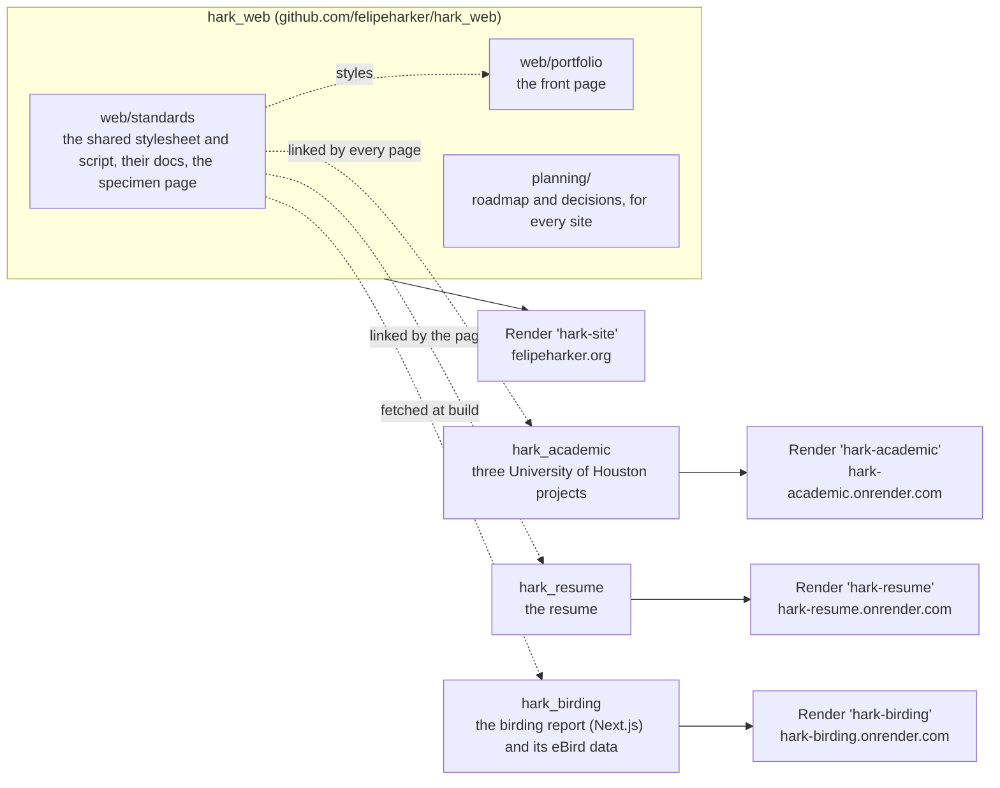
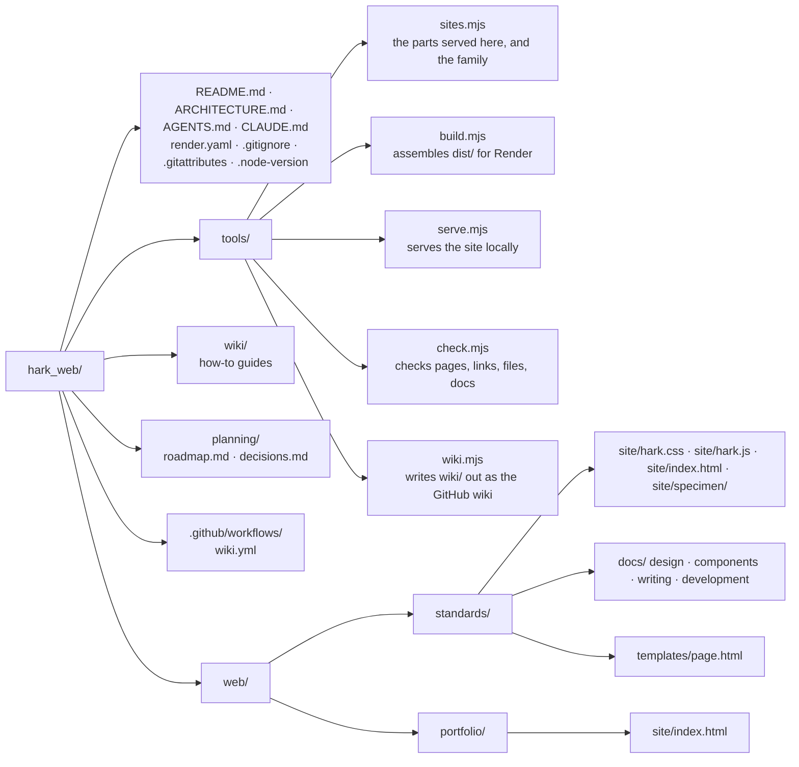
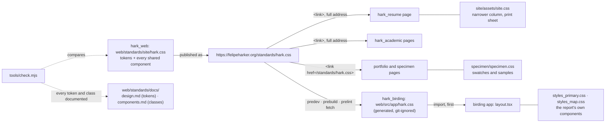
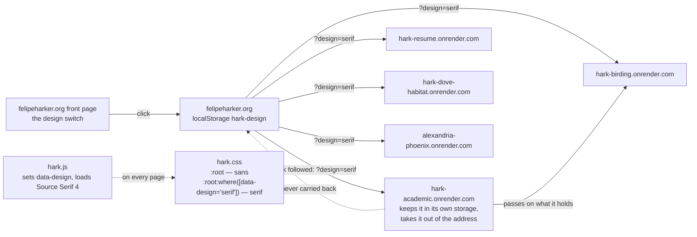
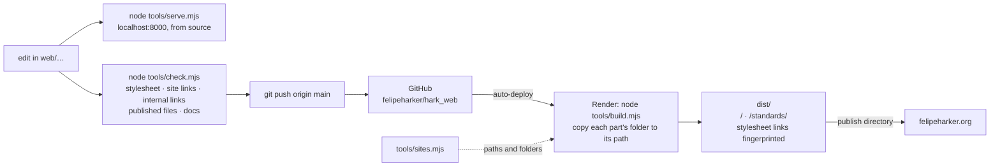
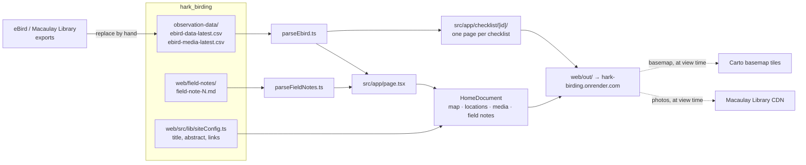
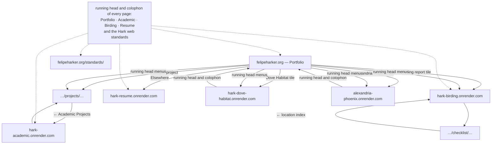

# Architecture

How felipeharker.org and the sites beside it are put together: what lives in
which repository, how the sites relate to each other, how a change becomes a
live site, and what sits outside the repositories. The diagrams render on
GitHub; every box names a real repository, folder, file or service.

- [The whole system](#the-whole-system)
- [This repository](#this-repository)
- [One stylesheet](#one-stylesheet)
- [One script, two designs](#one-script-two-designs)
- [From a commit to a live site](#from-a-commit-to-a-live-site)
- [The birding report's data](#the-birding-reports-data)
- [How a reader moves around](#how-a-reader-moves-around)
- [Outside the repositories](#outside-the-repositories)

## The whole system

Four public repositories build four static sites, each on its own Render
service. `hark_web` serves felipeharker.org — the portfolio and the standard
— and its one stylesheet styles all four.

| Address | Repository, folder published | What it is |
|---|---|---|
| https://felipeharker.org/ | `hark_web`, `web/portfolio/site/` | The front page: a tile for each academic project and one for the birding report, About, Elsewhere |
| https://felipeharker.org/standards/ | `hark_web`, `web/standards/site/` | The specimen page, and `/standards/hark.css` itself |
| https://hark-academic.onrender.com/ | `hark_academic`, `site/` | Living Outside the Box, Dead Mall Fall, Collingsworth Marketplace — a page each |
| https://hark-birding.onrender.com/ | `hark_birding`, `web/out/` (built) | The Harker Ornithology Report: map, locations, media, field notes, one page per checklist |
| https://hark-resume.onrender.com/ | `hark_resume`, `site/` | The resume, printable |

## This repository

Every part keeps what it publishes in a `site/` folder and nothing else
there: no Markdown, notes, models or PDFs. The other three repositories have
the same shape at their root — `site/`, git-ignored `source/` (or the birding
report's `notebook/`), and `tools/` with `site.mjs`, `serve.mjs` and
`check.mjs` — except the birding report, whose app in `web/` writes
`web/out/`.

## One stylesheet

There is one shared stylesheet, `web/standards/site/hark.css` in this
repository. Nothing copies it except the birding app, which needs it at
build time.

A site's own stylesheet loads after `hark.css`, may read and redefine its
tokens, and holds only what no other site needs. A component a second site
needs moves into `hark.css`. A change to `hark.css` reaches the static sites
as soon as `hark-site` deploys, and the birding report on its next build.

## One script, two designs

The standard has two designs, sans (the default) and serif, and one shared
script, `web/standards/site/hark.js`, served beside the stylesheet at
`https://felipeharker.org/standards/hark.js`. Every page links it in its
`<head>`; it sets `<html data-design>` before the page is drawn. The
choice is made only on felipeharker.org's front page. Each site is its own
origin with its own storage, so the choice crosses to another site in the
address of the link the reader follows, and that site keeps it.

The front page alone decides: felipeharker.org never takes a value from
an address, and links to it never carry one. Parametric Living and
Parametric Reference are outside the family, on their own copy of the
standard, and keep their one design; nothing here links them any more.

## From a commit to a live site

Each repository deploys on its own; this is `hark_web`'s path. The others
are the same, without the build step for the static ones, and with
`cd web && npm ci && npm run build` for the birding report.

`tools/sites.mjs` lists the parts served here and the family of sites; the
build, the local server and the check all read it.
`node tools/build.mjs && node tools/serve.mjs --dist` shows exactly what
Render will publish.

## The birding report's data

Nothing about birds is written into markup. Every page is built from files
in `hark_birding` at build time; images and map tiles come from outside
services when a reader opens the page.

## How a reader moves around

Every page on every site opens with a running head and ends with a colophon,
each carrying the same site links, so any site is one click from any other. Links between the sites are absolute and stay in the
same tab, except the portfolio's tiles, which open each project in a new
tab; links to anyone else open a new one. Dove Habitat and Alexandria
Phoenix, project sites, are reached from their tiles, and their running
heads and colophons lead home to the portfolio alone. The portfolio's own running head is the one with menus:
Academic, Professional and Birding open onto every project under them, in
the same tab.

## Outside the repositories

| What | Where | Relationship |
|---|---|---|
| The live sites | Render static sites `hark-site`, `hark-academic`, `hark-birding`, `hark-resume` (project Hark, workspace Harker-Hub) | Each builds its repository's `main` on every push; `hark-site` serves felipeharker.org and www |
| The old paths | `hark-site`'s Redirects/Rewrites | `/academic/*`, `/birds/*`, `/resume/*` → the same path on the new site |
| DNS | Porkbun | `felipeharker.org` A record → Render; `www` CNAME → `hark-site.onrender.com`; `birds` CNAME → the birding redirect service; `resume` and `academic` → Porkbun's URL forwarding |
| resume.felipeharker.org, academic.felipeharker.org | Porkbun URL forwarding | Permanent redirects to the resume's and the academic site's front pages; nothing on Render |
| birds.felipeharker.org | Render service `hark-birding-redirect` (the old birding site) | Kept only to redirect to hark-birding.onrender.com |
| resume-site-0rfl.onrender.com | Render service `hark-resume-redirect` (the old resume site) | Kept only to redirect to hark-resume.onrender.com |
| `hark_portfolio_archive`, `hark_resume_archive`, `hark_birding_archive` | GitHub, archived | The three repositories the 2026-10-19 monorepo replaced; read-only, with their histories. None of the current repositories was made from them |
| `hark_system_archive`, `hark_references_archive`, `hark_parametric_*_archive` | GitHub, archived | The old CODEBASE standards, an unused references repository, and the old parametric repositories |
| `CODEBASE\parametric` | the private `parametric_*` repositories | The Rhino and Grasshopper work and its own standards; nothing here depends on it |
| alexandria-phoenix.onrender.com | Render static site, from the private `alexandria_phoenix` (its `site/`) | A project site built to the standard: it links `hark.css` and `hark.js` from here, so it follows the reader's design. The portfolio's top row links it from a tile, in a new tab, and the running head from its Professional menu; its own running head and colophon lead home to the portfolio. Nothing here builds or changes it |
| parametric-living.onrender.com | Render static site `parametric-living`, from the private `parametric_living` | Its own site, outside the family and its standard. Still live, but no longer linked from here (2026-10-27); nothing here builds or changes it |
| parametric-reference.onrender.com | Render static site `parametric-reference`, from the private `parametric_reference` | The same: still live, outside the family on its own copy of the standard, and no longer linked from here (2026-10-27) |
| The GitHub wiki | github.com/felipeharker/hark_web/wiki | A copy of `wiki/`, replaced by `.github/workflows/wiki.yml` on every push to `main` that changes it |
| Fonts | Google Fonts, by a `<link>` on every page (the birding app's in its `layout.tsx`) | Inter and IBM Plex Mono; Source Serif 4, loaded by `hark.js` for the serif design |
| hark-dove-habitat.onrender.com | Render static site `hark-dove-habitat`, from the public `hark_dove_habitat` | A project site, opened from its portfolio tile and from the birding report's Reference section; its running head and colophon link the portfolio alone |
| dove-habitat.onrender.com | Render service `dove-habitat` (the old Dove Habitat site, from `dove_habitat_archive`) | Kept only to redirect to hark-dove-habitat.onrender.com |
| Photos and map tiles | Macaulay Library CDN, Carto | Loaded by the birding report in the reader's browser |
